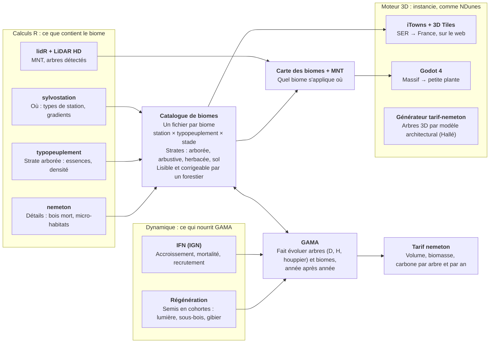

# Architecture : le biome au centre

Le catalogue de biomes relie les calculs à la 3D.

Ce schéma reprend le tableau blanc du projet (état du 24 novembre 2026) : <https://claude.ai/artifact/DKaryvwdnEHPTbxhFXNaRt>. Le lien n'est accessible qu'aux personnes avec qui le tableau a été partagé. En cas d'écart, `BRIEF.md` fait foi : il intègre notamment la décision sur la hauteur (MNH LiDAR HD et potentialité de la station), postérieure au tableau.

## Lecture

| Bloc | Rôle |
|---|---|
| Calculs R | disent ce que contient un biome et où il s'applique |
| Catalogue de biomes | contrat entre les calculs et la 3D |
| Dynamique | alimente la simulation : accroissement, mortalité, recrutement, régénération |
| GAMA | fait évoluer arbres et biomes |
| Tarif nemeton | convertit chaque arbre simulé en volume, biomasse et carbone |
| Moteur 3D | n'invente rien : il instancie ce que décrit le biome |

Le prototype de la vue massif est dans `viewer-massif/`.
